# Engine Spine & Port Contracts (`code/engine/crates/sim-spine`)

**Module ID:** `ENG-SPINE-00`  
**Code Location:** `code/engine/crates/sim-spine/`  
**Milestone & Design Depth:** `M0–M7: Authoritative Spine Contract`  
**Supports Requirements:** `ENG-MOD-001`, `ENG-CLK-003`, `ENG-CLK-004`, `ENG-EPI-001` in [engine_requirements.md](file:///home/roger/Projects/ng/requirements/engine_requirements.md)  

---

## 1. Architectural Mandate: Spine + Cartridge Isolation

Every engine subsystem is authored as an independent workspace crate ("Cartridge") communicating exclusively through narrow, versioned Rust traits, opaque strongly-typed IDs, and deterministic phase queues declared inside `code/engine/crates/sim-spine`. Sibling cartridges SHALL NEVER declare Cargo dependencies on each other or import each other's internal structs, arenas, or helper functions.

```mermaid
flowchart TD
    SPINE["code/engine/crates/sim-spine (Opaque IDs, Port Traits, TickPhase Bus, Plug Hooks)"]
    MOD["02 sim-data (Mod & Schema Loader)"] --> SPINE
    CLK["03 sim-clock (Hourly Clock & Sharding)"] --> SPINE
    GEO["04 sim-planet (Continuous Sphere Field & Materials)"] --> SPINE
    WTH["05 sim-weather (Atmosphere & Hydrology)"] --> SPINE
    ECO["06 sim-economy (Physical Goods & Production)"] --> SPINE
    LOG["07 sim-logistics (Carriers & Route Graph)"] --> SPINE
    POP["08 sim-pop (Cohorts & Named Characters)"] --> SPINE
    EPI["09 player-view (Epistemic Air-Gap & IPC)"] --> SPINE
    CMD["10 sim-command (Attention & Mandates)"] --> SPINE
    SCN["11 sim-scenario and sim-cli"] --> SPINE
    P12["12 sim-plug-private-eco (M5 Plug)"] --> SPINE
    P13["13 sim-plug-research (M6 Plug)"] --> SPINE
    P14["14 sim-plug-warfare and succession (M7 Plug)"] --> SPINE
```



---

## 2. Opaque Strongly-Typed Identifiers

All cross-module identifiers wrap unsigned integers as `Copy + Clone + Eq + Ord + Hash + Debug` newtypes inside `sim-spine`. Raw internal arena generations or slab slot pointers remain strictly private to each cartridge.

| Spine ID Type | Backing Width | Domain Semantics |
| :--- | :--- | :--- |
| `Tick` | `u64` | Discrete simulation hour index starting at `0` |
| `CellId` | `u32` | Subdivided icosphere spherical terrain sample node index (zero hex tiles) |
| `EdgeId` | `u32` | Directed or undirected sample-to-sample adjacency corridor |
| `PlateId` | `u16` | Tectonic plate identifier |
| `WatershedId` | `u32` | Hydrological drainage basin identifier |
| `SettlementId` | `u32` | Named settled site or outpost identifier |
| `FacilityId` | `u32` | Productive facility, mine, farm, or workshop identifier |
| `StockpileId` | `u32` | Spatial inventory yard, granary, warehouse, or cargo bay |
| `BatchId` | `u64` | Distinct physical commodity batch stamped with purity and age |
| `CommodityId` | `u16` | Interned external commodity definition index |
| `ProcessId` | `u16` | Interned extraction, refining, farming, or building recipe index |
| `CarrierClassId` | `u16` | Interned carrier class definition index |
| `ConvoyId` | `u64` | Active physical moving transit entity identifier |
| `InfraClassId` | `u16` | Interned road, bridge, canal, port, or rail class index |
| `CohortId` | `u32` | Grouped demographic cohort per settlement and vocation |
| `VocationId` | `u16` | Interned occupational skill domain index |
| `CharacterId` | `u32` | Named Individual (leader, overseer, general, scholar, merchant) |
| `ActorId` | `u32` | Legal entity (state bureau, household, estate, merchant house, syndicate) |
| `MandateId` | `u64` | Issued strategic directive or delegated sub-mandate |
| `ProposalId` | `u64` | Subordinate escalation proposal awaiting arbitration |
| `DispatchId` | `u64` | Physical courier message or signal packet in transit or archived |
| `TechComponentId` | `u16` | Modular empirical Know-How component identifier |
| `TheoryDomainId` | `u16` | Theoretical Know-Why scientific domain identifier |
| `FormationId` | `u32` | Military division, corps, or field detachment identifier |
| `TheaterId` | `u16` | Operational military theater identifier |
| `EventClassId` | `u16` | Interned notification and auto-pause event category index |

**Design Invariant on `ActorId`:** Starting in `M3`, all stockpiles, facilities, and shipments carry an `ActorId` owner tag (initially the Colony Authority actor). When `M5` introduces private households, landed estates, merchant houses, and chartered syndicates, zero `M3` ledger structs require refactoring.

---

## 3. Narrow Read-Only Ports, Command Queues & Pre-Wired Plug Hooks

### 3.1 Core `M0`–`M4` Read-Only Ports & Mutation Queues

```rust
pub trait ModRegistryPort: Send + Sync {
    fn commodity_def(&self, id: CommodityId) -> &CommodityDefView;
    fn process_def(&self, id: ProcessId) -> &ProcessDefView;
    fn carrier_def(&self, id: CarrierClassId) -> &CarrierDefView;
    fn infra_def(&self, id: InfraClassId) -> &InfraDefView;
    fn vocation_def(&self, id: VocationId) -> &VocationDefView;
    fn event_class_id(&self, key: &str) -> Option<EventClassId>;
    fn calendar_config(&self) -> &CalendarConfigView;
}

pub trait PlanetGeometryPort: Send + Sync {
    fn cell_count(&self) -> u32;
    fn cell_neighbors(&self, cell: CellId) -> &[CellId];
    fn cell_edge(&self, from: CellId, to: CellId) -> Option<EdgeId>;
    fn cell_elevation_m(&self, cell: CellId) -> f32;
    fn cell_slope_rad(&self, edge: EdgeId) -> f32;
    fn cell_biome_and_strata(&self, cell: CellId) -> CellGeologyView;
    fn watershed_downstream(&self, cell: CellId) -> Option<CellId>;
    fn great_circle_km(&self, a: CellId, b: CellId) -> f32;
    fn nearest_sample_cell(&self, unit_xyz: [f32; 3]) -> CellId;
    fn sample_elevation_at_unit_xyz(&self, unit_xyz: [f32; 3]) -> f32;
    fn icosphere_triangles(&self) -> &[[u32; 3]];
    fn watershed_id(&self, cell: CellId) -> WatershedId;
    fn region_label(&self, cell: CellId) -> String;
}

pub trait SurfaceConditionsPort: Send + Sync {
    fn surface(&self, cell: CellId) -> SurfaceConditionSnapshot;
    // Fields: precip_mm_hr, mud_index_01, flood_stage_01, snow_depth_m,
    //         ice_thickness_m, temp_c, wind_u_mps, wind_v_mps, visibility_01
}

pub trait PhysicalLedgerPort: Send + Sync {
    fn stockpile_mass_kg(&self, stock: StockpileId, commodity: CommodityId, owner: Option<ActorId>) -> f64;
    fn settlement_stockpiles(&self, settlement: SettlementId) -> &[StockpileId];
    fn apply_ledger_commands(&mut self, cmds: &[LedgerCommand]) -> Vec<LedgerReceipt>;
}

pub trait LogisticsPort: Send + Sync {
    fn convoy_state(&self, convoy: ConvoyId) -> Option<ConvoyTransitView>;
    fn enqueue_shipment(&mut self, req: ShipmentRequest) -> ConvoyId;
    fn enqueue_courier(&mut self, env: CourierEnvelope) -> DispatchId;
    fn arrived_envelopes(&self) -> &[ArrivedCourierEnvelope];
}

pub trait PopulationPort: Send + Sync {
    fn settlement_cohorts(&self, settlement: SettlementId) -> &[CohortId];
    fn cohort_view(&self, id: CohortId) -> CohortSnapshotView;
    fn character_view(&self, id: CharacterId) -> CharacterSnapshotView;
    fn apply_labor_and_welfare(&mut self, updates: &[CohortDelta]);
}

pub trait CommandPort: Send + Sync {
    fn attention_summary(&self, who: CharacterId) -> AttentionLoadView;
    fn active_mandates_for(&self, who: CharacterId) -> &[MandateView];
    fn ingest_player_command(&mut self, tick: Tick, cmd: ValidatedPlayerCommand);
}
```

### 3.2 Pre-Wired `M5`–`M7` Plug-In Extension Ports

To ensure `M5`–`M7` plug in with zero architectural rewrite of `M0`–`M4`, `sim-spine` defines five plug-in traits initialized with neutral `M0`–`M4` baseline adapters:

1. `NonStateEconomyPlugPort` (`M5`): Evaluates private actor production/arbitrage commands, multi-medium settlement clearing, shared edge congestion multipliers, and carrier charter rates (`M0`–`M4` default: zero congestion penalty, zero non-state arbitrage).
2. `GovernanceFrictionPlugPort` (`M5`): Evaluates multi-hop hierarchy lag/filtering, Goodhart quota purity distortion, clerical overhead consumption, and reform inertia across governance models (`M0`–`M4` default: direct linear delegation without bureaucratic tiers).
3. `KnowledgeModifierPlugPort` (`M6`): Evaluates whether a settlement satisfies four-carrier knowledge prerequisites for a `ProcessId`, handles workplace bottleneck observations, patent restrictions, and knowledge decay (`M0`–`M4` default: processes gated strictly by scenario-enabled recipes and tool availability).
4. `OperationalCombatPlugPort` (`M7`): Executes hourly `TheaterDirective` ("Churchill Mode") and `OperationalBattlePlan` ("Hitler Mode") steps coupled to `SurfaceConditionsPort` (`M0`–`M4` default: no active warfare step).
5. `SuccessionPlugPort` (`M7`): Resolves mortal player incapacitation/death/deposition and transfers `CartographicArchive`, ledgers, institutions, and debts to the successor (`M0`–`M4` default: no succession transition).

---

## 4. Deterministic Eight-Phase Hourly Tick Pipeline

The coordinator executes one deterministic hourly tick in strict sequential phases (parallelism via `rayon` operates strictly *inside* each phase over disjoint spatial/entity buckets using index-sorted reductions):

| Order | `TickPhase` | Scheduling Rate | Primary Cartridges Active |
| :--- | :--- | :--- | :--- |
| `1` | `IngestPlayerCommands` | Every tick (`1h`) | `sim-clock`, `sim-command`, `player-view` |
| `2` | `HourlyWeatherAndHydrology` | Every tick (`1h`) | `sim-weather` (updates `SurfaceConditionsPort`) |
| `3` | `HourlyCombatStep` | Every tick (`1h`) | `sim-plug-warfare` (reads `SurfaceConditionsPort`) |
| `4` | `HourlyCourierAndSignalStep` | Every tick (`1h`) | `sim-logistics` (advances couriers and HQ travel) |
| `5` | `DailyBucketLogisticsAndMarkets` | `entity_id % 24 == tick % 24` | `sim-logistics`, `sim-plug-private-eco` |
| `6` | `DailyBucketExtractionProductionConstruction` | `facility_id % 24 == tick % 24` | `sim-economy`, `sim-plug-research` |
| `7` | `WeeklyMonthlyBucketDemographicsMandatesResearch` | `entity_id % 168 == tick % 168` | `sim-pop`, `sim-command`, `sim-plug-private-eco`, `sim-plug-research`, `sim-plug-succession` |
| `8` | `CompileDiegeticPlayerViewAndNotifications` | Every tick (`1h`) | `player-view`, `sim-scenario` (`NotificationRouter`) |

---

## 5. Compile-Time & CI Isolation Enforcement

1. **Workspace Crate DAG Rule:** Each cartridge lives in its own Rust crate inside `/home/roger/Projects/ng/code/engine/Cargo.toml`. Only `sim-scenario` and `sim-cli` (composition roots) depend on multiple cartridges simultaneously to wire Spine traits together. No cartridge crate may list another cartridge crate in `[dependencies]`.
2. **Automated CI DAG Guard (`cargo xtask check-isolation`):** Executes `cargo metadata --no-deps` and verifies that for every cartridge crate `C`, its direct workspace dependencies are a subset of `{sim-spine, sim-data}`.
3. **Deterministic Collection Lints:** Workspace `clippy.toml` and `#![deny(clippy::disallowed_types)]` forbid `std::collections::HashMap` and `std::collections::HashSet` in simulation crates, requiring deterministic ordered maps (`BTreeMap`, `BTreeSet`) or fixed-seed `IndexMap`.
4. **Epistemic Type Wall:** Only `code/engine/crates/player-view` may depend on `serde` IPC response serialization attributes targeting the Electron bridge; ground-truth `sim-core` state structs never derive IPC response DTO traits.
