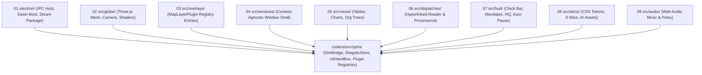

# UI Spine, State Bus & IPC Contracts (`code/ui/src/spine`)

**Module ID:** `UI-SPINE-00`  
**Code Location:** `code/ui/src/spine/`  
**Milestone & Design Depth:** `M0–M7: Authoritative UI Spine Contract`  
**Satisfies Requirements:** `UI-SHL-002`, `UI-SHL-005` in [ui_requirements.md](file:///home/roger/Projects/ng/requirements/ui_requirements.md)  

---

## 1. Architectural Mandate: UI Spine + Plugin Cartridges

Every frontend subsystem (`electron/`, `globe/`, `overlays/`, `windows/`, `views/`, `dispatches/`, `hud/`, `skins/`, `audio/`) communicates exclusively through `code/ui/src/spine/`. No UI cartridge may import TypeScript symbols, DOM refs, or Three.js objects from a sibling cartridge.



---

## 2. Typed IPC Bridge & Deterministic Offline Mock Playback

### 2.1 `SimBridgeApi` (Exposed via Preload `contextBridge`)

```typescript
export interface SimBridgeApi {
  subscribeSnapshots(listener: (snapshot: DiegeticSnapshot) => void): () => void;
  sendPlayerCommand(command: ValidatedPlayerCommand): Promise<CommandAck>;
  listAvailableSkins(): Promise<readonly SkinDescriptor[]>;
  readSkinAssetManifest(skinId: string): Promise<SkinManifestBundle>;
  loadMockFixture(fixtureJson: string): Promise<void>; // Active in mock-test mode (UI-SHL-005)
}
```

### 2.2 Immutable `DiegeticStore` Selectors

`DiegeticStore` wraps the latest `DiegeticSnapshot` received from `code/engine/crates/player-view` (never raw `sim-core` state) and exposes memoized read-only selectors:
1. `selectGlobeTopology(store)` — welded subdivided icosphere sample coordinates and spherical triangle mesh buffers (hex-free Option B)
2. `selectKnownCells(store)` — explored, rumored, and timestamped surveyed terrain sample states
3. `selectHqPresence(store)` — current stationary or in-transit HQ continuous unit coordinate and sight radius
4. `selectTrackedConvoys(store)` — confirmed, ghosted dead-reckoning, and overdue expedition markers at continuous spherical positions
5. `selectObservedWeather(store)` — hourly physical surface states restricted strictly to observed/reported sample regions
6. `selectLedgerRows(store, kind)` — reported stockpiles, cohorts, facilities, and provenance tags
7. `selectDelegationTree(store)` — Attention utilization, subordinate mandates, and pending escalation proposals
8. `selectDispatchInbox(store)` — chronological arrived dispatches and active auto-pause banners
9. `selectClockAndNotifications(store)` — formatted scenario calendar/hour, run state, and 4-tier event rules plus M5–M7 institution, knowledge, warfare, and succession slices

### 2.3 Typed `UiIntentBus` & Plugin Registries

```typescript
export type UiIntent =
  | { kind: "FlyGlobeToCell"; cellId: number; zoomAltitude?: number }
  | { kind: "FocusEntityInspector"; entityKind: EntityKind; entityId: number; pinned?: boolean }
  | { kind: "OpenSystemWindow"; pluginId: string; instanceKey?: string; pinned?: boolean }
  | { kind: "CloseWindow"; windowId: string }
  | { kind: "SwitchMapOverlayMode"; modeId: string }
  | { kind: "PreviewHqLatencyRoute"; destinationCellId: number | null }
  | { kind: "SwitchActiveSkin"; skinId: string }
  | { kind: "PlayUiFoley"; cueId: string }
  | { kind: "DispatchSimCommand"; command: ValidatedPlayerCommand };

export interface MapLayerPlugin {
  readonly layerId: string;
  readonly displayName: string;
  readonly supportsMode: (modeId: string) => boolean;
  mount(host: GlobeLayerHost, store: DiegeticStoreAccess, bus: UiIntentBus): void;
  onSnapshotUpdate(snapshot: DiegeticSnapshot): void;
  onFrameRender(cameraAltitudeNorm: number, elapsedSec: number): void;
  dispose(): void;
}

export interface WindowContentPlugin {
  readonly pluginId: string;
  readonly defaultTitle: string;
  readonly minWidth: number;
  readonly minHeight: number;
  readonly maxWidth?: number;
  readonly maxHeight?: number;
  mountContent(container: HTMLElement, instanceKey: string, spine: UiSpineContext): () => void;
}
```

### 2.4 `MockSnapshotPlayer` (`UI-SHL-005`)

Runs inside Vitest and Playwright harnesses without launching Rust binaries: feeds frozen `tests/fixtures/*.json` `DiegeticSnapshot` sequences on demand (`stepMockSnapshot(index)`), recording every emitted `ValidatedPlayerCommand` into an assertion queue.

---

## 3. Compile-Time & ESLint Boundary Isolation Rules

ESLint enforces strict directional imports (`eslint-plugin-boundaries` / `no-restricted-imports`) across `code/ui/src/`:
1. `src/spine/**` may import only pure TypeScript types and utility math—zero imports from Electron Node APIs, Three.js scene modules, DOM window implementations, or feature views.
2. Each cartridge directory (`globe`, `overlays`, `windows`, `views`, `dispatches`, `hud`, `skins`, `audio`) may import **only** from `src/spine/**` and its own directory. Any import crossing between two sibling cartridges fails `npm run lint` with an architectural boundary error.
3. Zero inline color hex codes (`#...`), font-family literals, or direct `.ogg`/`.wav`/`.mp3` string constants outside `src/skins/` and `src/audio/` test fixtures.
