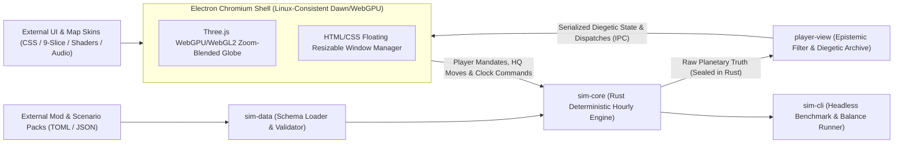

# Master Game Concept, Requirements & Technical Architecture Specification

**Project Location:** `/home/roger/Projects/ng`  
**Document Type:** Living Requirements & System Architecture Baseline  
**Genre:** Diegetic Command & Civilization Strategy Simulation  

---

## 1. Document Overview & Core Design Philosophy

This project is a realistic, single-player strategy and civilization simulation built around physical causality, imperfect human institutions, and strict player epistemological limits. Rather than presenting a polished dashboard of omniscient spreadsheets and pre-packaged upgrade trees, the simulation models a living world where information, materials, skills, and authority must all move through physical space and fallible people.

### 1.1 The Six Core Gameplay Pillars

All six pillars are coupled through shared physical inventory, labor, energy, and communication graphs:

1. **Exploration:** Dispatching provisioned survey teams, coastal scouts, and mapping expeditions across an unmapped planet to chart terrain, watersheds, hazards, and probable mineral belts.
2. **Research:** Practical problem-solving, component discovery, and eventual theoretical synthesis emerging organically from physical bottlenecks, material experimentation, and surplus intellectual labor.
3. **Construction:** Building settlements, workshops, mines, roads, bridges, canals, harbors, fortifications, and institutions through real material deliveries, skilled labor hours, and weather-sensitive field work.
4. **Resource Extraction:** Surveying, opening, draining, timbering, and working geological deposits, forests, fisheries, and agricultural soils whose true yields and complications reveal themselves through labor rather than tile tooltips.
5. **Logistics:** Moving physical mass across real terrain gradients, rivers, oceans, and seasonal infrastructure using human porters, draft animals, watercraft, rail, and motorized carriers shared between state and private actors.
6. **Population Management:** Sustaining and governing multi-generational demographic cohorts alongside named leaders, specialists, and competing social institutions under shifting health, nutrition, literacy, skill retention, and political cohesion.

### 1.2 Dual Sources of Systemic Friction

Gameplay pushback emerges simultaneously from two non-scripted sources:

1. **Natural, Physical & Internal Socio-Economic Pressures:** Resource depletion, shaft flooding, seasonal winters, torrential storms, organic spoilage, tool wear, epidemic disease, skill extinction, labor shirking, strikes, banditry, and bureaucratic decay.
2. **External Polities & Factions:** Rival settlements, sovereign states, confederations, and trading powers interacting through bilateral trade, diplomacy, technological diffusion, industrial espionage, border friction, and armed warfare.

### 1.3 Two Foundational Realism Axioms

1. **No Bought Research:** Technologies are never purchased with abstract "science points" from a visible or pre-determined tech tree. Discovery requires physical materials, working prototypes, skilled practitioners, surplus time, and intellectual inquiry.
2. **No God-Like Knowledge:** Neither the player nor the graphical interface possesses omniscient truth about the planet. Every terrain contour, ore grade, stockpile count, demographic census, convoy location, and battle report displayed to the player is an imperfect human artifact shaped by survey instruments, clerk literacy, travel latency, and subordinate honesty.

---

## 2. The Player's Diegetic Seat, Lifespan & Scenarios

### 2.1 Single Mortal Person at a Physical Headquarters

The player does not inhabit an immortal national spirit or an orbiting observer camera. The player embodies one mortal individual occupying a concrete geographic coordinate—their Headquarters (HQ)—on the planetary sphere:

- **Immediate HQ Locality:** Within immediate line-of-sight and walking distance of the player's physical HQ, the player observes local work, weather, stockpiles, and operations directly with zero communication delay.
- **Everywhere Beyond HQ:** Information and orders operate under strict two-way physical latency. Directives travel outward from HQ to regional administrators and commanders, while surveys, ledgers, requests, and battle dispatches travel inward to HQ via runners, riders, sailing vessels, telegraph wires, or radio transmissions according to available infrastructure and era technology.
- **Physical HQ Relocation:** The player may pack up and relocate their physical HQ to inspect a frontier mine, oversee a canal project, or sit closer to a military front. Doing so immediately grants direct local clarity at the new site while automatically introducing travel latency back to capital ministries and distant settlements.

### 2.2 Multi-Era Engine & Generational Succession

- **Era-Agnostic Simulation Rules:** Core mechanics are rooted in physical mass, thermodynamics, hydrology, demography, transport economics, and organizational span-of-control rather than scripted historical ages. This allows a single continuous campaign—or separate modded scenarios—to span pre-industrial settlement, Age of Sail expansion, early industrialization, mechanized warfare, and high-technology colonization.
- **Succession Continuity:** When the player character dies of age, disease, accident, assassination, or political deposition, gameplay continues through a successor (heir, elected magistrate, council appointee, or revolutionary rival depending on governance rules). The successor inherits *only* the existing physical cartographic archive, paper or digital ledgers, standing bureaucracies, treaties, debts, and entrenched officials—never magical knowledge lost with the predecessor's unrecorded memory.

### 2.3 Configurable Starting Scenarios & Initial Vertical Slice

The engine supports arbitrary user-defined starting configurations grouped into three primary world-generation archetypes:

1. **Emergent Dawn:** A nascent sedentary settlement taking its earliest steps in an uncharted wilderness.
2. **Expedition / Colony:** A landing party anchored on an unfamiliar coast or continent with finite initial equipment, a skilled founding cadre, and optional distant homeland charters or expectations.
3. **Governor / Successor:** Assuming office inside an established regional polity burdened by incomplete archives, entrenched oligarchs or nobles, and nearby rival powers.

#### Primary Vertical-Slice Development Scenario: "The Unexplained Colony"

Development targets **"The Unexplained Colony"** as Scenario Pack 1 (authored strictly in external data files):

- **Narrative Premise:** The player awakens as the appointed or recognized leader of an isolated colony whose origins and external sponsors are intentionally left unexplained.
- **Initial State:** One coastal or riverine settlement, a small multi-cohort founding population, 3 to 5 named subordinates with distinct competencies and reporting flaws, vast uncharted surrounding terrain on a spherical globe, and a finite reserve of high-grade starting tools and supplies that steadily degrade through use.
- **Organic Design Loop:** Degrading starting tools establish an immediate real-time survival imperative—survey nearby geology, secure sustainable caloric production, open local extraction and smelting, and train apprentices before inherited tools break beyond repair. As the colony survives and establishes satellite outposts, private commerce, supply bottlenecks, bureaucratic span-of-control strain, and discovery mechanics activate naturally without requiring external rival empires to be present on Day 1.

---

## 3. Command, Delegation, Span of Control & Bureaucratic Friction

### 3.1 Finite Attention Budget

Every named person—both the player and every subordinate leader—has a finite **Attention Capacity** (approximately 4 to 7 closely supervised direct reports or active hands-on initiatives, modulated by personal organizational competence and clerical support tools):

- Staying within Attention Capacity preserves tight oversight, rapid bottleneck resolution, and faithful execution.
- Exceeding Attention Capacity induces non-linear **Oversight Dilution** across all supervised assignments: subordinates slack off, skim supplies, falsify progress reports, defer hard maintenance, or substitute easier self-serving tasks for difficult mandates.

### 3.2 Cascading Strategic Mandates

The player operates through strategic outcome mandates rather than low-level unit or tile placement:

- **High-Level Mandate Issuance:** The player issues broad directives—for example, *"Increase structural metal production"* or *"Connect the northern basin to Port Haven for bulk grain haulage"*—and assigns responsibility to an official, institution, or market procurement office.
- **Autonomous Subordinate Decomposition:** The assigned leader breaks the mandate down according to their competence, personality, and available intelligence into concrete operational tasks: commissioning geological surveys, drafting or hiring laborers, expanding mine shafts, securing timber and fuel supplies, contracting haulers, or requesting capital disbursements.

### 3.3 Minute-to-Minute Player Agency

Delegating execution does not turn the player into a passive spectator. Active play centers on two deliberate decision loops:

1. **Arbitrating Bottlenecks & Competing Proposals:** Subordinates regularly escalate conflicts beyond their local authority or budget—for example, a flooded deep shaft requiring a choice among diverting state timber and 400 workers, financing an experimental drainage mechanism, or granting a 20-year extraction monopoly to a merchant syndicate; or clogged ore roads forcing a decision between grain priority and metal expansion.
2. **Spending Personal Attention to Zoom In:** Whenever a venture is critical, the player may dedicate scarce Personal Attention slices (and optionally travel on-site) to prescribe detailed priorities, inspect physical ledgers, or formulate operational battle plans—knowing that every slice of Attention spent zooming in reduces supervision across unattended ministries.

### 3.4 The Four Frictions of Organizational Hierarchy

Adding intermediary managers resolves the player's personal Attention bottleneck, but every added layer in a chain of command introduces four structural frictions:

1. **Signal Lag & Filtering:** Detailed intent degrades as orders pass downward through clerks and deputies, while field problems are delayed, softened, or concealed coming upward by fearful, incompetent, or sycophantic officials.
2. **Metric Gaming (Goodhart's Law):** Any quantitative quota issued without rigorous physical inspection causes subordinates to optimize the reported number at the expense of real value—shipping heavy, brittle, slag-contaminated ingots to hit tonnage targets, or high-grading shallow veins while collapsing deep shafts.
3. **Administrative Overhead:** Scribes, bookkeepers, inspectors, tax assessors, and bureau chiefs consume food, housing, wages, and scarce literate labor without producing physical raw materials, and actively lobby to preserve or expand their offices.
4. **Institutional Inertia:** Established departments, guild halls, and military staffs resist process innovations or reorganizations that threaten their budgets, status, or hard-won procedural monopolies.

### 3.5 Governance & Coordination Mechanisms (Trade-Off Matrix)

Political reforms, administrative tools, and institutional charters shift *which* friction dominates without ever eliminating friction entirely:

| Coordination Model | Core Mechanism & Enablers | Primary Strengths | Inherent Structural Frictions |
| :--- | :--- | :--- | :--- |
| **Direct Personal / Patrimonial Rule** | Player and trusted inner circle directly supervise tasks | Near-zero administrative overhead, fast crisis action, high personal loyalty | Collapses sharply past small scale; severe crisis upon leader illness or succession |
| **Devolved Fiefs & Tax Farming** | Local notables govern districts and remit fixed tribute or rents | Negligible central overhead; self-polices basic local order | High revenue skimming, inconsistent standards, risk of autonomous regional warlords |
| **Standardized State Bureaucracy** | Writing, double-entry ledgers, standard weights and measures, exams, audits, telegraph, computing | Scales across massive populations and territories; standardized reporting archives | Heavy clerical overhead, slow tactical pivots, intense metric gaming without costly audits |
| **Guilds & Chartered Monopolies** | Self-regulating craft associations or exclusive corporate charters | High product quality control and reliable apprenticeship retention at low state cost | Artificially restricts output to elevate prices; suppresses labor-saving innovations |
| **Open Markets, Contracts & Patents** | State posts purchase prices, subsidies, tariffs, or monopoly patent terms | Mobilizes private extraction and haulage autonomously with minimal state Attention | Volatile boom-bust cycles, war profiteering, extreme wealth inequality, patent obstructionism |

---

## 4. Two-Tier Population & Character Simulation

To support populations ranging from hundreds in an early outpost to millions in mature civilizations without flattening human agency, society is simulated across two coupled tiers.

### 4.1 Tier 1: Demographic Cohorts

Population is grouped per settlement or district and by occupation or social stratum into tracked cohorts carrying six core state dimensions:

1. **Age Structure:** Explicit distributions across dependents/children, prime working-age adults, and elders—driving natural birth rates, age-specific mortality, available labor force, dependency burdens, and permanent loss of unrecorded expertise when elder masters die without apprentices.
2. **General Education & Literacy:** Determines capacity to comprehend written mandates, maintain accurate accounting ledgers, conduct calibrated land and geological surveys, operate complex machinery, and read or transcribe technical archives.
3. **Practical Domain Experience:** Vocation-specific proficiency (surface quarrying, deep mining, ore beneficiation and smelting, charcoal burning, carpentry and timber framing, stone masonry, arable farming, animal husbandry and driving, seamanship and navigation, cartography, clerical accounting, weapon smithing, military drill) accrued strictly through active labor or apprenticeship and decaying during prolonged idleness or cohort disruption.
4. **Health, Nutrition & Stamina:** Caloric adequacy, micronutrient variety, shelter insulation, occupational injury exposure, endemic pathogen load, and cumulative fatigue—directly governing physical labor output, endurance, fertility, and epidemic lethality.
5. **Household Wealth & Material Reserves:** Physical reserves of staple food, cooking and heating fuel, weather-appropriate clothing, and personal working tools held at the household level.
6. **Social Cohesion & Political Disposition:** Trust in central leadership, localized grievances, perceived fairness of levies and prices, and occupational solidarity—governing work diligence versus passive slowdown, tax resistance, out-migration, organized strikes, banditry, and rebellion.

### 4.2 Tier 2: Named Individuals

Promoted out of experienced cohorts—or arriving in starting cadres—Named Individuals serve as governors, ministers, engineers, master artisans, survey captains, military commanders, scholars, and private syndicate heads:

1. **Domain Competence:** Concrete proficiency ratings across technical engineering, organizational logistics, fieldcraft and surveying, theoretical inquiry, and operational military command.
2. **Cognitive & Research Traits:** Intellectual curiosity, experimental rigor and methodicalness, and intellectual orthodoxy versus readiness to challenge conventional wisdom.
3. **Epistemic & Reporting Traits:**
   - *Honesty versus Sycophancy:* Whether uncomfortable failures, shortages, and defeats are reported truthfully or minimized to curry favor.
   - *Precision versus Sloppiness:* Measurement error variance and record-keeping discipline in submitted censuses, cargo manifests, and geological estimates.
   - *Caution versus Alarmism:* Systematic underestimation versus exaggeration of threats, resource depletion, and enemy numbers.
4. **Personal Drives:** Loyalty to leadership or institutions, personal ambition, susceptibility to greed and embezzlement, and interpersonal compatibility or rivalry with other Named Individuals.

---

## 5. Non-Bought Research, Fragile Knowledge & Procedural Science

### 5.1 Solving the Creator's Paradox: Procedural Materials Under Real Physical Laws

Because the creator of the game builds its underlying rules, fixed real-world recipes (for instance, static iron-coke ratios or invariant crop properties) would grant the creator meta-game god-knowledge during play. The engine solves this cleanly:

- **Invariant Physical Laws:** Mass conservation, bulk density, thermal transfer, phase transition temperatures, structural yield strength, hardness versus brittleness trade-offs, chemical reactivity, corrosion, caloric nutrition, organic spoilage curves, and biological contagion follow realistic, deterministic physics.
- **Procedurally Generated Natural World:** Every generated planet rolls distinct **metallic ores, trace mineral impurities, smelting fluxes, fossil and biological fuels, edible and fiber crops, draft and wild fauna, and local pathogens** constrained to physically plausible trade-off spaces. Both the player and the game's creator must genuinely sample, assay, test, and experience materials in-world to learn how a planet's specific ores smelt, which fluxes remove brittleness, and which crops fail in early frost.

### 5.2 Two-Track Knowledge Architecture: Know-How vs. Know-Why

Technological capability splits into two interacting but independent tracks:

1. **Know-How (Empirical Techniques & Reusable Physical Components):**
   - Composed of proven material processes and modular physical components (high-pressure vessels, bored cylinders, pistons, check and slide valves, rotary cranks, lenses, refractory kiln linings, water-resistant timber hulls).
   - Emerges from **contact with physical bottlenecks**: flooded deep shafts motivate drainage pumps; brittle castings motivate impurity testing and flux experimentation; heavy wagon axles breaking in mud motivate wheelwright and metallurgy refinements.
   - **Component Cross-Pollination:** Once a working device (for instance, an atmospheric steam mine-drainage pump) physically exists in a workshop, its constituent proven components become observable physical precedents—dramatically reducing the trial-and-error cost for mechanics elsewhere to adapt those same components into adjacent machines (rotary mill engines, river steamboats, rail locomotives).
2. **Know-Why (Theoretical Understanding):**
   - Produced by individuals freed from full-time subsistence labor (leisure-class natural philosophers, patronized scholars, university researchers, and salaried laboratory scientists) studying both natural phenomena and *already-functioning machines* (mirroring how thermodynamics was derived from working steam engines).
   - **Historical Inversion:** Early in development, empirical Know-How leads Know-Why by decades. Once theoretical Know-Why matures in a scientific domain (thermodynamics, metallurgy, chemistry, electromagnetism, bacteriology), intentional directed research becomes vastly faster, safer, and more predictable.

### 5.3 Institutional Modes of Innovation

How research happens evolves dynamically alongside society, literacy, economic surplus, and political institutions:

1. **Surplus Leisure & Workplace Tinkering:** Spontaneous trial-and-error by practitioners facing bottlenecks and curious individuals supported by agrarian or commercial surplus.
2. **State Prizes & Military Arsenals:** Problem-specific public bounties and state-funded war workshops spurred by maritime hazards, fortification arms races, and active military campaigns.
3. **Private Patents & Monopoly Profit:** Legal frameworks enabling private inventors and syndicates to capture time-limited monopoly rents—accelerating private capital investment into practical inventions while actively restricting follow-on improvements and competing uses by rivals until patents expire, are reverse-engineered, or are leaked.
4. **Universities, Corporate R&D Labs & State Directed Science:** High-overhead institutional laboratories fusing systematic Know-Why with engineering tooling, viable only once widespread literacy, deep capital accumulation, and foundational scientific theory exist.

### 5.4 Fragile, Embodied Knowledge

Discoveries are never permanent global account unlocks. Every capability persists exclusively across four physical, vulnerable carriers:

1. **Practicing Vocational Cohorts** performing daily work and training apprentices.
2. **Living Named Specialists** carrying tacit design mastery.
3. **Operational Prototypes, Precision Tooling & Dies** housed inside physical workshops.
4. **Written or Printed Archives** stored inside physical libraries, guild halls, and bureaus.

Plagues killing master cohorts, fires or sieges destroying archives and toolshops, or prolonged economic shutdowns severing apprenticeship chains cause genuine technological regression unless the knowledge has been widely dispersed across multiple settlements and printed manuals.

---

## 6. Unified Public & Private Economy & Physical Logistics

This system is explicitly architected to advance beyond *Shadow Empire* across four structural limitations:

1. **No Hard-Coded Public/Private Building Locks:** Productive buildings are not arbitrarily split into "state-only" or "private-only" catalogs; ownership depends on prevailing laws, capital availability, and state policy.
2. **Concrete Non-State Actors Instead of Faceless Zone Blobs:** Private economic activity is executed by distinct households, landed estates, merchant houses, craft guilds, and syndicates with persistent inventories, capital, and political agendas.
3. **Physical Carriers Instead of Abstract Logistics Points:** Freight throughput is governed by actual vehicles, draft animals, watercraft, crews, fuel/fodder, and shared road or port congestion—never recalculated abstract points.
4. **Era-Universal Accounting:** Replaces fixed modern cash-and-tax assumptions so barter, commodity money, in-kind tribute, corvée labor, metallic coinage, bank credit, and command requisitioning function seamlessly within one unified engine.

### 6.1 Single Physical Goods Ledger

Every physical unit of grain, timber, raw ore, smelted metal, charcoal, coal, finished tools, weapons, clothing, and livestock resides at an explicit spatial location—a settlement granary, mine yard, warehouse, harbor dock, or moving carrier cargo hold—tagged with its legal owner, purity/quality grade, condition, and spoilage age.

### 6.2 Distinct Non-State Economic Actors

1. **Households & Smallholders:** Subsistence-first producers prioritizing family calories, winter fuel, and personal tool replacement before trading or selling residual surplus into local markets or satisfying rent obligations.
2. **Landed Estates & Clans:** Rural powerholders extracting in-kind crops and labor services from local populations, hoarding regional grain reserves during scarcity, and resisting central census and tax agents.
3. **Merchant Houses & Hauling Guilds:** Independent trading organizations monitoring regional price disparities across their own messenger networks and dispatching private caravans or cargo vessels to capture spatial price arbitrage.
4. **Syndicates, Craft Guilds & Chartered Companies:** Capital-pooling associations capable of financing deep mine shafts, blast furnaces, shipyards, canals, railways, and proprietary research whenever anticipated commercial return outweighs physical and political risk.

### 6.3 Shared Physical Logistics Network

- **Carrier Classes:** Human porters, pack animals, animal-drawn carts and heavy wagons, river barges, coastal sailing vessels, ocean-going ships, rail locomotives and rolling stock, and motorized transport convoys.
- **Infrastructure Classes:** Unimproved wilderness tracks, cleared footpaths, graded earth roads, paved highways, river fords, timber and masonry bridges, navigable river channels, locked canals, harbors and docks, and light or heavy rail lines.
- **Shared Network Collision:** State Quartermaster convoys and private merchant haulers traverse the same physical road corridors, bridge weight limits, harbor berths, and regional charterable carrier pools. Requisitioning or hiring private wagons for a military offensive or mega-project immediately bids up freight rates and crowds out civilian grain and fuel deliveries.

### 6.4 Cross-Era Economic Policy Levers

- **Tribute & Corvée Labor:** Direct physical levies of crops, materials, and seasonal compulsory labor hours for pre-currency and feudal administrations.
- **Market Purchase Orders, Subsidies & Tariffs:** Posting guaranteed state purchase prices or customs rules to induce autonomous private prospecting, extraction, and hauling with zero state bureaucratic Attention cost.
- **Concessions & Chartered Monopolies:** Granting private syndicates exclusive regional extraction, transport, or trade rights in exchange for upfront buildout and royalty shares, saving state capital while entrenching powerful oligarchs.
- **Direct State Enterprises:** Capitalizing state-owned mines, arsenals, and transport fleets under appointed directors to guarantee state priority allocation at the cost of clerical overhead, metric gaming, and Attention drain.

---

## 7. Planetary Sphere, Geology, Dynamic Weather & Operational Warfare

### 7.1 Geodesic Spherical Planet

The world is modeled as a true closed sphere tessellated as a **Goldberg polyhedron** (hexagonal cells plus exactly 12 pentagonal topological vertices), eliminating polar map stretching and preserving uniform cell geometry across every continent and ocean:

- **Tectonics & Mineral Belts:** Simulated plate collisions and rifting form mountain chains, volcanic arcs, sedimentary basins, and geologically coherent ore and fuel belts—allowing skilled geological surveyors to deduce promising prospect corridors from exposed strata and topography.
- **Rotation, Axial Tilt & Hydrology:** Planetary rotation, axial obliquity, elevation gradients, and oceanic circulation drive reversed north/south seasons, global prevailing wind gyres (governing sailing exploration and naval logistics), orographic rain shadows, continuous watershed elevation trees, and variable-flow navigable rivers.

### 7.2 Dynamic Physical Weather Engine

Hourly atmospheric and surface state variables per cell (`precipitation intensity`, `soil saturation and mud depth`, `river discharge and flood stage`, `ambient temperature, frost, and snowpack`, `surface wind vector`, and `optical visibility`) act directly as physical rules across every simulation system:

- **Battlefield Effects:** Heavy rain saturates terrain into mud that mires artillery, cavalry, and supply wagons; swollen rivers sweep away fords and temporary bridges, splitting army wings; wet conditions foul exposed bowstrings and propellants; fog and storm bands blind recon scouts and slow battlefield runners.
- **Logistics Effects:** Saturated roads double draft animal fodder burn and increase wheel/axle failures; winter freezes turn navigable rivers into impassable barriers for barges while opening temporary ice crossings; blizzards seal mountain passes; gales delay or wreck sailing convoys.
- **Extraction & Construction Effects:** Sustained downpours flood open pits and deep mines lacking drainage pumps, and halt lime-mortar masonry, brick curing, and heavy earthworks.
- **Agriculture & Storage Effects:** Droughts, unseasonable frosts, harvest rain rot, and damp granary spoilage alter food availability dynamically.

### 7.3 Operational Warfare: "Churchill vs. Hitler" Command Spectrum

Warfare explicitly rejects real-time unit micromanagement in favor of a continuous delegation spectrum rooted in historical command friction:

- **Strategic / Theater Delegation ("Churchill Mode"):** The player appoints theater commanders, sets strategic front priorities, and allocates logistics tonnage and reserve cohorts. Consumes minimal Personal Attention while allowing competent generals to adapt dynamically to mud, river washouts, supply shortages, and enemy counterattacks.
- **Operational Battle Planning ("Hitler Mode"):** The player invests high Personal Attention to directly prescribe division or corps avenues of advance, phased operational objectives, and rigid doctrines (including explicit *"No Retreat"* orders). While permitting tight operational direction, it suppresses subordinate local initiative; when headquarters sits hundreds of kilometers behind the front and weather cuts courier or wire links, formations continue executing yesterday's orders based on fragmented, stale information—risking encirclement disasters unless bold generals violate orders.
- **HQ Proximity Trade-Off:** Moving the player's physical HQ closer to an active theater cuts operational military dispatch latency at the direct expense of slower governance communication back to the capital and industrial core.

---

## 8. Time Scale, Multi-Rate Simulation Clock & Event Notifications

### 8.1 Base Time Resolution & Player Clock Controls

- **Base Tick Resolution:** `1 tick = 1 simulated hour` (`8,760 ticks` per standard 365-day year, parameterized per scenario calendar).
- **Clock Controls:** Instant full pause, single-tick stepping (`+1 hour`), slow observational speeds for battles and local storms, and accelerated multi-day or multi-week progression speeds for peaceful seasons and demographic growth.

### 8.2 Staggered Multi-Rate Tick Architecture

To keep high acceleration speeds responsive without flattening hourly physical fidelity, systems execute across three staggered frequency tiers using deterministic sharding across the 24 hours of each day:

1. **Hourly Execution (every tick):** Atmospheric advection and precipitation updates, active operational and tactical battle steps, physical courier and signal movement along routes, and direct inspection updates within the player's HQ locality.
2. **Daily Execution (partitioned deterministically across 24 hourly buckets):** Carrier convoy transit resolution, extraction and industrial workshop batch outputs, construction progress ticks, and local spot market price clearing.
3. **Weekly & Monthly Execution (partitioned evenly across hourly buckets):** Demographic cohort aging, fertility, mortality, disease incidence, and migration; practical skill gain and decay; private syndicate investment, expansion, and insolvency checks; clerical audit cycles; and Know-How / Know-Why research breakthrough evaluations.

### 8.3 Configurable Notification & Auto-Pause Rules

Every event class (arrived survey dispatch, overdue expedition or convoy alert, localized famine or stockpile exhaustion warning, battle onset or outcome report, empirical workplace observation, theoretical discovery, labor strike or unrest, notable leader death, succession event, private concession proposal) can be individually configured by the player to one of four delivery behaviors:

1. `Log Only` (recorded silently in chronological archive).
2. `Banner Notification` (non-blocking visual toast with hyperlink).
3. `Dispatch Popup` (opens or highlights an in-world document window without pausing).
4. `Dispatch Popup + Auto-Pause` (immediately halts simulation clock and presents the dispatch).

---

## 9. Recommended Technical Stack & System Architecture

### 9.1 Architectural Overview

The application is split across a strict process and serialization boundary: a native multithreaded **Rust Simulation Backend** containing absolute planetary truth and an explicit epistemic projection layer, paired with an **Electron Chromium Frontend** hosting a GPU-accelerated Three.js WebGPU/WebGL2 spherical renderer and a CSS-skinnable desktop-class windowing interface.



### 9.2 Backend Architecture (Rust)

- **`sim-core` (Pure Simulation Kernel):** Deterministic, multithreaded simulation engine built with `rayon` data parallelism and cache-friendly ECS/arena storage. Contains zero hardcoded game content and zero rendering dependencies.
- **`sim-data` (Schema & Mod Pipeline):** Powered by `serde` and `schemars` to validate external `TOML` and `JSON` definitions against strict schemas at startup and resolve layered mod load orders cleanly.
- **`player-view` (Strict Epistemic Air-Gap):** Guarantees architectural enforcement of the *No God-Like Knowledge* axiom. The raw world state never crosses IPC into the frontend. Instead, `player-view` maintains and updates the player's **Diegetic Knowledge State**:
  - Last-surveyed terrain, settlement, and mineral overlays stamped with observation age, surveyor precision, and confidence intervals.
  - Physical dispatches and ledgers that have actually arrived at HQ, complete with any bias or omissions injected by intermediary leaders.
  - Ghosted dead-reckoning markers showing *expected* positions of distant caravans, fleets, and expeditions based on departure schedules and last confirmed sightings, snapping to updated coordinates only when new reports reach HQ or flagging as overdue if overdue thresholds pass.
- **`sim-cli` (Headless Simulation Harness):** Standalone command-line binary executing multi-decade simulations headless at 50,000+ ticks per second for automated regression testing, AI behavior profiling, and economic balance verification.

### 9.3 Frontend Architecture (Electron + TypeScript + Three.js + HTML/CSS)

- **Why Electron Over Tauri on Linux:** Electron bundles a self-contained Chromium runtime with Google Dawn (providing reliable Vulkan-backed WebGPU and WebGL2 across Linux Wayland, X11, NVIDIA, AMD, and Intel driver stacks). Tauri was explicitly evaluated and rejected because its reliance on Linux system `WebKitGTK` exposes severe Wayland/NVIDIA DMABUF freezes, resize protocol crashes, and immature WebGPU support.
- **Zoom-Blended Spherical Map Renderer:**
  - **Low & Medium Altitude (Physical Mode):** GPU shaders render 3D topographic relief, bathymetry, flowing rivers, terrain biomes, settlement structures, road networks, active storm fronts, precipitation sheets, snow accumulation, and mud saturation directly onto the geodesic sphere.
  - **High Orbital Altitude (Cartographic Map Mode):** As the camera zooms out, shader blending smoothly cross-fades physical 3D relief into a **hand-drawn parchment topographic map** featuring inked contour lines, frontier blankness or hearsay sketches in unexplored regions, aged survey timestamps, trade flow vectors, and confirmed versus ghosted unit/convoy markers.
- **Desktop-Class Skinnable Window Manager:**
  - Every UI panel (ledgers, dispatches, surveys, command org trees, settlement inspectors, construction queues, research archives, notification filters) operates as an authentic in-game window supporting **drag-repositioning, multi-edge and corner resizing, minimize/collapse to header bar, close, click-to-raise z-order focusing, viewport clamping, and layout snap/tab docking**.
  - Built in TypeScript + HTML/CSS to enable virtualized 10,000+ row sortable and filterable tables, crisp multi-series time-series charts, interactive hierarchical org charts, and rich hyperlinked dispatches (clicking any settlement, leader, or convoy name opens or focuses its corresponding window).

---

## 10. 100% Data-Driven Moddability Architecture (Zero Game Content in Code)

### 10.1 Architectural Mandate

Rust code is restricted strictly to universal mechanics: conservation of mass and energy, geodesic geometry, hydrological flow, transport graph routing, market clearing, demographic cohort transitions, Attention dilution math, epistemic filtering, and schema validation. **No materials, crops, technologies, buildings, unit templates, eras, or starting scenarios reside in compiled source code.**

### 10.2 Load Order & Validation

All external content is authored in human-readable `TOML` or `JSON` manifests, layered deterministically at campaign launch (`core-schemas` -> `era-pack` -> `scenario-pack` -> `user-mods` -> `ui-skin`) and validated against generated JSON Schemas with clear line-level diagnostic error reporting.

### 10.3 Exhaustive Catalog of Externalized Data Domains

1. **Planetary Generation & Procedural Natural Distributions:** Globe resolution settings, tectonic plate count and uplift curves, axial tilt and solar constant ranges, climate rules, and procedural property spaces for ores, trace impurities, fluxes, fuels, flora, fauna, and pathogens.
2. **Commodities, Materials & Knowledge Primitives:** Commodity classifications, mass/volume ratios, thermal and structural curves, spoilage rates, Know-How reusable component primitives, and Know-Why theoretical domain graphs.
3. **Industrial, Agricultural & Construction Processes:** Extraction methods, smelting and refining recipes, tool fabrication, construction bills of labor and material, and maintenance/wear curves.
4. **Carriers & Infrastructure:** Carrier definitions (energy source, payload mass/volume, terrain/grade capabilities, crew requirements) and infrastructure classes (throughput caps, build costs, weather vulnerability, maintenance burn).
5. **Population Cohorts & Demographics:** Age bracket thresholds, vocational skill definitions, nutritional and material subsistence baskets, fertility and mortality curves, and literacy propagation parameters.
6. **Named Individuals & Succession:** Trait dictionaries, competence axes, epistemic bias profiles (sycophancy, precision, alarmism), personal drive weights, and succession rules.
7. **Governance, Institutions & Economic Policy:** Governance archetypes, office and bureau definitions, mandate decomposition templates, audit rules, patent duration/enforcement parameters, and taxation or tribute laws.
8. **Military Formations & Doctrines:** Formation templates, equipment slots, operational doctrine modifiers (initiative versus strict obedience), and weather-combat interaction curves.
9. **Scenarios & Calendars:** Starting planet seeds or heightmap overrides, initial settlements, founding cohorts, starting named cadres, initial degrading equipment reserves, starting survey fog-of-war coverage, and calendar naming—including **"The Unexplained Colony"** implemented entirely as a standalone mod pack.
10. **Notifications, Templates & Localization:** Event category schemas, default auto-pause presets, parameterized dispatch narrative templates, and string localization tables.
11. **UI Skins & Map Visual Themes:** External `.css` stylesheets, theme token variables, 9-slice window frame definitions, typography declarations, icon atlas mappings, audio manifests, and globe shader palettes.

---

## 11. AI-Generated Art, Visuals & Audio Pipeline

All graphical, cartographic, portrait, icon, and audio assets are AI-generated and integrated through automated normalization scripts and data-driven asset manifests so visual richness never becomes a manual art bottleneck:

1. **UI Skins & 9-Slice Window Chrome:** AI-generated era-appropriate window borders and panel skins (aged vellum and wood, hammered bronze, riveted industrial brass, monochrome CRT telemetry), scrollbars, dividers, button states, and wax seals processed via automated border-slicing and alpha-masking scripts into standardized 9-patch image sets referenced cleanly by CSS `border-image` tokens.
2. **Character Portraits, Icons & Dispatch Illustrations:** Prompt-templated portraits for Named Individuals tagged by age bracket, culture/era attire, vocation, health status, and temperament; palette-normalized vector or pixel-crisp icon sets for commodities, carriers, structures, and mandates; and atmospheric header plates paired with major dispatches.
3. **Planetary & Cartographic Textures:** Seamless tileable PBR material maps (bedrock, topsoil, saturated mud, snowpack, woodland canopy, farmland), seamless parchment/paper grain overlays, topographic ink-hatching brushes, decorative compass roses, and multi-octave weather/cloud textures.
4. **Soundscapes, UI Foley & Dynamic Music:** Era-matched seamless music stems, camera-altitude-reactive ambient audio (surface wind, rainfall, thunder, distant hammers, and storm-muffled battle din when zoomed into the globe transitioning smoothly to quiet study ambiance, hearth crackle, clock ticks, or quill scratch when zoomed out to the strategic map), and skin-matched UI foley (parchment rustle, wax seal press, brass ledger latch, telegraph key tap) wired via external audio manifest files.

---

## 12. Commercial Steam Distribution, Zero-Royalty Licensing & AI Provenance Compliance

The entire technical stack is verified for closed-source commercial sale on Steam with zero engine royalties or revenue-sharing fees while maintaining open-source license compliance and complete asset provenance:

1. **Zero-Royalty Core Stack Verification:** The Rust toolchain (`rustc`, `cargo`, and vetted workspace crates), Electron, Chromium, Node.js, Three.js, and TypeScript are all governed by permissive, zero-royalty open-source licenses (`MIT`, `Apache-2.0`, `BSD-2-Clause`, `BSD-3-Clause`, `ISC`), imposing zero per-copy royalties, seat fees, or revenue caps on commercial Steam releases.
2. **Strict Copyleft & Paid-Widget Ban:** Because commercial proprietary game binaries and Valve's Steamworks SDK agreement prohibit linking strict copyleft dependencies (`GPL`, `AGPL`, static `LGPL`, `SSPL`) or non-commercial media (`CC-BY-NC`), automated CI gates (`cargo-deny` for Rust crates plus SPDX license auditing across npm packages, fonts, and skin manifests) enforce an explicit permissive allowlist (`MIT`, `Apache-2.0`, `BSD-2-Clause`, `BSD-3-Clause`, `ISC`, `Zlib`, `0BSD`, `Unicode-3.0`, `CC0-1.0`, and `OFL-1.1` for typography) and forbid paid or proprietary third-party data grid and charting widgets.
3. **Optional Steamworks Boundary & Electron `.asarUnpack` Packaging:** All core Rust crates (`sim-core`, `sim-data`, `player-view`, `sim-cli`) and the Electron frontend build, execute, and pass their complete automated test suites with zero proprietary SDK dependencies present. Optional Steamworks integration (`steamworks-rs` or `napi-rs`, dual-licensed `MIT`/`Apache-2.0`) lives strictly behind a feature-gated adapter module. Release builds configure `asarUnpack` so native `.node` addons, Rust shared libraries, `libsteam_api.so`, and `steam_api64.dll` reside outside `app.asar`, bundle `LICENSES.chromium.html` alongside aggregated `THIRD_PARTY_NOTICES.txt`, and target both the Steam Linux Runtime and Windows `x86_64`.
4. **AI Asset Commercial Provenance & Steam Pre-Generated Disclosure:** Every shipped AI-generated visual texture, portrait, icon, illustration, music stem, ambient track, and UI foley sample requires an explicit provenance record inside `tools/asset-pipeline/` manifests documenting generator model name and version, commercial license tier, `commercial_rights_verified = true`, human post-processing steps, and Valve's pre-generated content category—blocking non-commercial model weights or free-tier non-commercial audio from release packages and automatically compiling accurate declarations for Valve's Steamworks AI Content Survey.

---

## 13. Proposed Workspace & Repository Layout

```text
/home/roger/Projects/ng/
├── code/
│   ├── engine/                        # Rust workspace root (Cargo.toml, deny.toml)
│   │   ├── crates/
│   │   │   ├── sim-spine/             # Opaque IDs, Spine port traits, TickPhase, plug traits
│   │   │   ├── sim-data/              # Serde + schemars mod loader, JSON Schema generator & validator
│   │   │   ├── sim-clock/             # Hourly clock, 24h/168h staggered scheduler, LZ4 save codec & profiler
│   │   │   ├── sim-planet/            # Goldberg sphere, tectonics, strata deposits, watersheds, procedural materials
│   │   │   ├── sim-weather/           # Hourly orbital insolation, advection, soil mud, snowpack & watershed flood routing
│   │   │   ├── sim-core/              # Deterministic kernel wiring stockpiles, production & population ports
│   │   │   ├── player-view/           # Epistemic air-gap, delayed dispatch inbox, ghosted schedule projection
│   │   │   ├── sim-scenario/          # Engine composition root wiring cartridges and scenario initialization
│   │   │   ├── steam-adapter/         # Optional Steamworks integration boundary (--features steam)
│   │   │   └── sim-cli/               # Headless multi-decade simulation runner, profiler & balance test suite
│   │   └── tools/
│   │       └── xtask/                 # License, DAG isolation, AI provenance, notice & requirement traceability auditor
│   └── ui/                            # Electron + TypeScript app (package.json, eslint.config.mjs)
│       ├── electron/                  # Main process, preload bridge & IPC command allowlist validator
│       ├── src/spine/                 # Immutable DiegeticStore, UiIntentBus, plugin registries & MockSnapshotPlayer
│       ├── src/globe/                 # Three.js WebGPU/WebGL2 Goldberg sphere & zoom-blended shaders
│       ├── src/overlays/              # Map overlay plugins (convoy trails, weather particles, hex contours)
│       ├── src/windows/               # Movable, resizable, minimizable, snappable window manager & mod diagnostics
│       ├── src/views/                 # Virtualized ledgers, charts, org trees
│       ├── src/dispatches/            # Delayed dispatch reader & epistemic confidence badges
│       ├── src/hud/                   # Command HUD, mandate authoring & notification matrix
│       ├── src/skins/                 # CSS skin engine & AI asset resolver
│       ├── src/audio/                 # Web Audio mixer & manifest-driven foley engine
│       ├── scripts/                   # npm/skin license audits & Steam ASAR staging/verification scripts
│       └── tests/                     # Vitest + headless Electron security, packaging & mock harness tests
├── design/
│   ├── engine/                        # Modular engine cartridge specifications
│   └── ui/                            # Modular UI cartridge specifications
├── mods/                              # 100% external TOML/JSON data packs (core-schemas, baseline-era, unexplained-colony)
├── requirements/
│   ├── architecture.md                # Master requirements & technical architecture specification
│   ├── engine_requirements.md         # Traceable Rust engine & epistemic air-gap requirements
│   └── ui_requirements.md             # Traceable Electron, globe & skinnable window UI requirements
├── schemas/                           # Generated Draft 2020-12 JSON Schemas for mod authoring
├── skins/
│   └── cartographer-parchment/        # Default external CSS skin, 9-slice window assets, map palette & audio manifest
└── tools/
    └── asset-pipeline/                # Manifests and scripts to verify & package AI-generated art & audio
```

---

## 14. Phased Vertical-Slice Development Roadmap

Development progresses through playable, testable milestones where the data-driven boundary and epistemic air-gap are enforced from the first line of code:

1. **Milestone 0 — Workspace & Contracts:** Initialize the Rust workspace (`sim-core`, `sim-data`, `player-view`, `sim-cli`), schema validation pipeline, and Electron + Three.js + movable/skinnable window shell skeleton.
2. **Milestone 1 — Headless Geodesic Planet & Clock:** Implement Goldberg polyhedron sphere generation, plate tectonics, procedural material/climate property tables, hourly weather simulation, and deterministic staggered multi-rate ticks benchmarked in `sim-cli`.
3. **Milestone 2 — Zoom-Blended Globe & Windowing Skin System:** Render the 3D physical globe smoothly cross-fading to a cartographic parchment map by camera altitude, backed by the movable, resizable, minimizable window manager loading external CSS skins (`cartographer-parchment`) and initial AI-generated textures.
4. **Milestone 3 — Epistemic Air-Gap & "The Unexplained Colony" Survival Loop:** Activate `player-view` fog-of-war/survey archives, single physical goods ledger, degrading initial tool supplies, local extraction, nutrition, and basic settlement construction strictly from `mods/unexplained-colony/`.
5. **Milestone 4 — Populations, Leaders, Attention & Delayed Dispatches:** Implement demographic cohorts, Named Individuals with epistemic traits, finite Attention budget, cascading mandates, physical courier latency, HQ relocation, and configurable notification/auto-pause rules.
6. **Milestone 5 — Autonomous Public/Private Economy & Shared Logistics:** Add distinct households, estates, merchant houses, and syndicates operating autonomous private production and price-arbitrage caravans sharing road/port capacity with state logistics, alongside governance friction mitigations.
7. **Milestone 6 — Non-Bought Procedural Research & Fragile Knowledge:** Implement empirical workplace observation, component-based Know-How propagation, leisure/patron/patent/lab Know-Why discovery, and physical knowledge fragility across cohorts, prototypes, and archives.
8. **Milestone 7 — Operational Warfare, Succession & Multi-Scenario Expansion:** Implement the "Churchill vs. Hitler" command delegation spectrum, weather-coupled operational combat, mortal leader succession continuity, rival polities, and additional era/scenario mod packs.
